# Sprawozdanie z Laboratorium 1: Pomiary podstawowych wielkości przy odczytach plików

Marta Hering-Zagrocka, 448297

## 1. Środowisko sprzętowe

- **System operacyjny:** Ubuntu 22.04.5 LTS (kernel `6.8.0-138-generic`, system plików `ext4`)
- **Procesor:** Intel Core i5-13600H (13th Gen), 12 rdzeni, 16 wątków, do 4.8 GHz, cache L3: 18 MiB
- **Pamięć RAM:** 31 GiB (+ 2 GiB swap)
- **Dysk:** Lexar SSD NM620 1TB NVMe PCIe (odczyt sekwencyjny specyfikacji: $\approx 3300\text{ MB/s}$)

--- 

## 2. Kompilacja i uruchamianie

### Struktura projektu

- Pliki z sufiksem `*_original` (`latency_original.rs`, `throughput_original.rs`, `pipeline_original.rs`) to implementacje wyjściowe (przed optymalizacjami).
- Pliki bez sufiksu (`latency.rs`, `throughput.rs`, `pipeline.rs`) to poprawione wersje programów.


### Kompilacja
Będąc w katalogu `projects/proj1/`:
- `make all`: kompiluje wszystkie programy.
- `make clean`: usuwa skompilowane pliki binarne oraz pliki tymczasowe testów.

### Uruchamianie pojedynczych programów
```bash
./src/target/release/latency_original <ścieżka> [rozmiar_bloku]
./src/target/release/latency <ścieżka> [rozmiar_bloku] [wątki]

./src/target/release/throughput_original <ścieżka> [rozmiar_bloku]
./src/target/release/throughput <ścieżka> [rozmiar_bloku]

./src/target/release/pipeline_original <ścieżka> [rozmiar_bloku] [iteracje]
./src/target/release/pipeline <ścieżka> [rozmiar_bloku] [iteracje]
```

### Format wyjścia programów
- `stdout`: ścieżka do pliku oraz wyliczony finalny skrót w postaci szesnastkowej.
- `stderr`: precyzyjne czasy zmierzone za pomocą `std::time::Instant`:
  - `latency`, `latency_original`: 
    - czas całkowity (`czas_całk_s`), 
    - liczba odczytów (`liczba_odczytów`), 
    - średni czas odczytu (`śr_odczyt_µs`),
  - `throughput`: 
    - czas całkowity (`czas_całk_s`),  
  - `throughput_original`: 
    - czas całkowity (`czas_całk_s`), 
    - czas odczytu I/O (`czas_odczyt_s`),
  - `pipeline`, `pipeline_original`: 
    - czas całkowity pipeline (`czas_całk_s`),
    - czas wątku I/O (`czas_odczyt_s`), 
    - czas wątku CPU (`czas_oblicz_s`).

---

## 3. Benchmark

Wszystkie pomiary można uruchomić automatycznie za pomocą dostarczonych skryptów:
```bash
make benchmark
```

Skrypty pomiarowe badają programy w dwóch stanach pamięci podręcznej systemu:
1. **Warm Cache:** plik przed pomiarem jest w całości wczytywany do pamięci RAM.
2. **Cold Cache:** pamięć podręczna systemu operacyjnego dla pliku jest czyszczona.
3. **Presja pamięciowa (Cold + limit pamięci):** badanie zachowania przy ograniczeniu pamięci podręcznej i procesu (np. `systemd-run --scope -p MemoryMax=...`), gdy rozmiar pliku przekracza dostępny bufor.

Dla każdego punktu pomiarowego wykonano 5 powtórzeń, a do analizy i wykresów przyjęto wartość minimalną w celu wyeliminowania losowego szumu systemowego.

Pomiary wykonano na czterech rozmiarach plików: **10 MB**, **50 MB**, **200 MB** (bez ograniczeń) oraz **500 MB** z limitem pamięci **MemoryMax=256M** (plik nie mieści się w cache). Główna tabela wyników odnosi się do pliku 50 MB, a w sekcji „Wpływ rozmiaru pliku" porównano zachowanie dla wszystkich rozmiarów.

Generowanie wykresów do raportu na podstawie pomiarów można uruchomić przez:
```bash
make plots
```

---

## 4. Wyniki pomiarów i wnioski

### Latency

Program czyta bloki pliku w losowej permutacji i sumuje ich skróty MD5 ($K=1$). 
Wersja oryginalna wykonuje synchroniczny odczyt pojedynczym wątkiem. 
Wersja poprawiona wykorzystuje pulę wątków wykonujących `read_exact_at()` (`pread`) 
i przekazuje dane do dedykowanego wątku obliczeniowego.

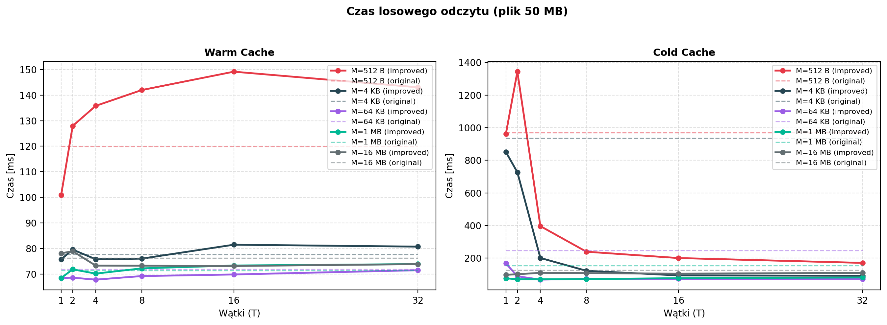
*Rysunek 1: Całkowity czas wykonania w funkcji liczby wątków czytających (plik 50 MB), porównujący wersję original (poziome linie przerywane — zawsze 1 wątek) z wersją po poprawce.*

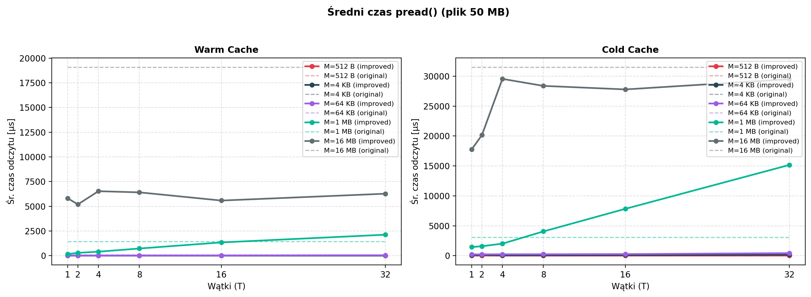
*Rysunek 2: Średni czas pojedynczego wywołania pread() w funkcji liczby wątków (plik 50 MB).*

#### Wyniki pomiarów — Warm Cache (plik 50 MB w RAM):

| Rozmiar bloku $M$ | Original 1T [ms] | Po poprawce 1T [ms] | Po poprawce 4T [ms] | Po poprawce 8T [ms] | Po poprawce 16T [ms] | Po poprawce 32T [ms] |
|:---:|:---:|:---:|:---:|:---:|:---:|:---:|
| **512 B** | 120.0 | 100.9 | 135.8 | 141.9 | 149.1 | 143.0 |
| **4 KB** | 77.7 | 75.8 | 75.9 | 76.1 | 81.5 | 80.8 |
| **64 KB** | 72.0 | 68.5 | 67.9 | 69.3 | 69.9 | 71.6 |
| **1 MB** | 71.5 | 68.5 | 70.2 | 72.3 | 73.4 | 74.0 |

#### Wyniki pomiarów — Cold Cache (plik 50 MB, odczyt z dysku):

| Rozmiar bloku $M$ | Original 1T [ms] | Po poprawce 1T [ms] | Po poprawce 4T [ms] | Po poprawce 8T [ms] | Po poprawce 16T [ms] | Po poprawce 32T [ms] |
|:---:|:---:|:---:|:---:|:---:|:---:|:---:|
| **512 B** | 970.2 | 961.4 | 396.4 | 239.5 | 200.7 | 170.9 |
| **4 KB** | 935.2 | 851.7 | 201.1 | 122.4 | 94.1 | 91.8 |
| **64 KB** | 247.7 | 168.0 | 68.3 | 73.2 | 73.2 | 71.7 |
| **1 MB** | 153.8 | 76.4 | 70.5 | 71.6 | 77.3 | 81.4 |
| **16 MB** | 126.0 | 97.8 | 110.0 | 108.3 | 104.7 | 109.8 |

#### Średni czas pojedynczego odczytu (śr_odczyt_µs) — Cold Cache:

| Rozmiar bloku $M$ | Original 1T [µs] | Po poprawce 1T [µs] | Po poprawce 4T [µs] | Po poprawce 8T [µs] | Po poprawce 16T [µs] | Po poprawce 32T [µs] |
|:---:|:---:|:---:|:---:|:---:|:---:|:---:|
| **512 B** | 9.5 | 8.5 | 11.4 | 10.0 | 12.3 | 18.3 |
| **4 KB** | 73.1 | 62.7 | 57.9 | 66.7 | 95.3 | 170.6 |
| **64 KB** | 309.6 | 206.1 | 226.9 | 236.8 | 261.7 | 424.5 |
| **1 MB** | 3075.8 | 1444.0 | 2008.5 | 4050.3 | 7832.0 | 15166.8 |
| **16 MB** | 31505.3 | 17765.4 | 29554.0 | 28384.8 | 27795.6 | 29504.8 |

#### Wpływ rozmiaru pliku na czas losowego odczytu (Cold Cache):

Poniżej czasy wersji original (1 wątek, Cold Cache) dla czterech rozmiarów plików. Plik 500 MB jest mierzony z limitem `MemoryMax=256M`, więc nie mieści się w cache.

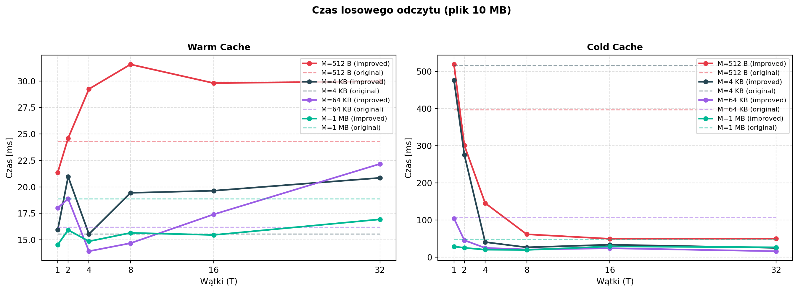
*Rysunek 3: Czas losowego odczytu w funkcji wątków — plik 10 MB (Cold Cache).*

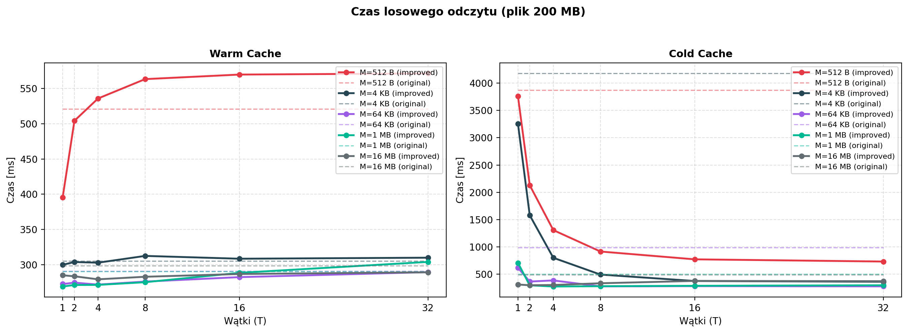
*Rysunek 4: Czas losowego odczytu w funkcji wątków — plik 200 MB (Cold Cache).*

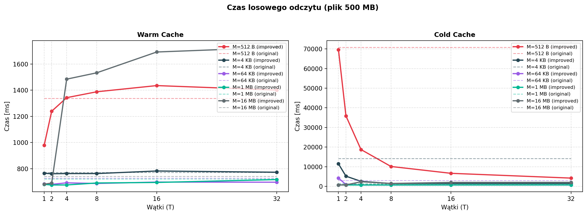
*Rysunek 5: Czas losowego odczytu w funkcji wątków — plik 500 MB (MemoryMax=256M, plik nie mieści się w cache).*

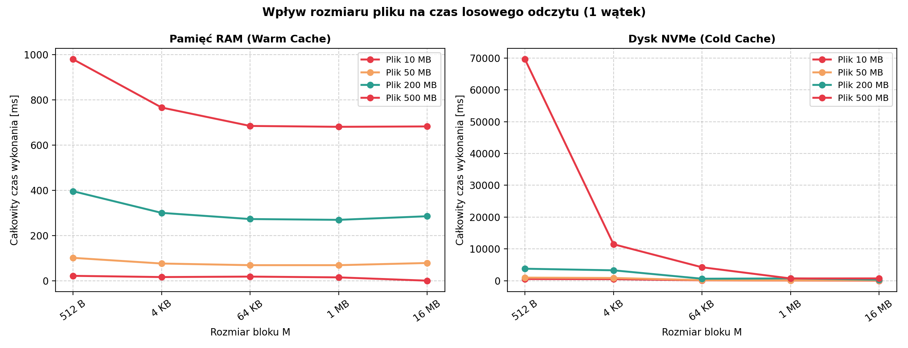
*Rysunek 6: Całkowity czas losowego odczytu w funkcji rozmiaru pliku (10–500 MB) dla różnych rozmiarów bloków M i liczby wątków.*

| Rozmiar bloku $M$ | 10 MB [ms] | 50 MB [ms] | 200 MB [ms] | 500 MB (256M) [ms] |
|:---:|:---:|:---:|:---:|:---:|
| **512 B** | 396.8 | 970.2 | 3872.2 | **70751.5** |
| **4 KB** | 516.2 | 935.2 | 4176.3 | **14124.4** |
| **64 KB** | 106.7 | 247.7 | 989.1 | **3037.3** |
| **1 MB** | 48.3 | 153.8 | 503.9 | **1345.3** |

Czas rośnie proporcjonalnie do rozmiaru pliku dla plików mieszczących się w cache (10–200 MB). Dla $M=512\text{ B}$ przejście z 10 MB na 200 MB (20-krotny wzrost) wydłuża czas z 397 ms do 3872 ms (**9.8x**). Plik 500 MB z limitem `MemoryMax=256M` pokazuje **drastyczny spadek wydajności** — dla $M=512\text{ B}$ czas wzrasta do **70752 ms** (**18.3x** więcej niż 200 MB bez limitu), ponieważ plik nie mieści się w cache i każda strona musi być doczytywana z dysku.

#### Średni czas pojedynczego odczytu — porównanie wszystkich rozmiarów plików:

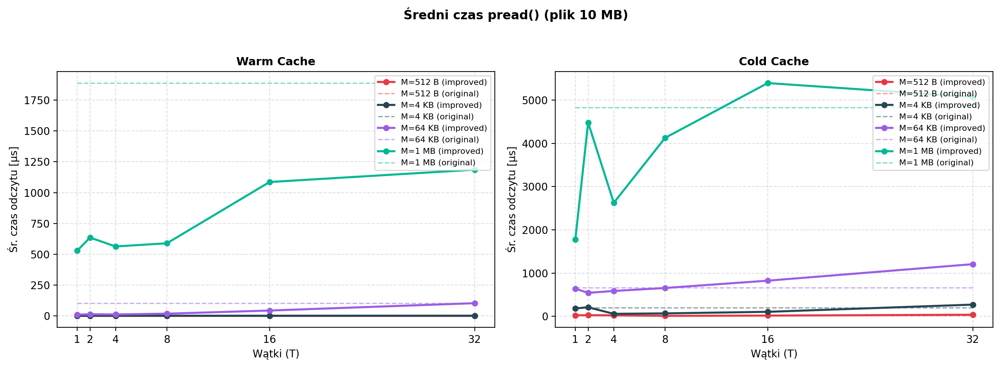
*Rysunek 7: Średni czas pojedynczego pread() — plik 10 MB (Cold Cache).*

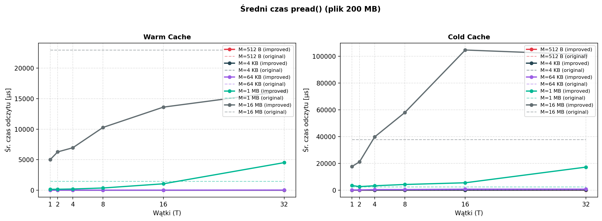
*Rysunek 8: Średni czas pojedynczego pread() — plik 200 MB (Cold Cache).*

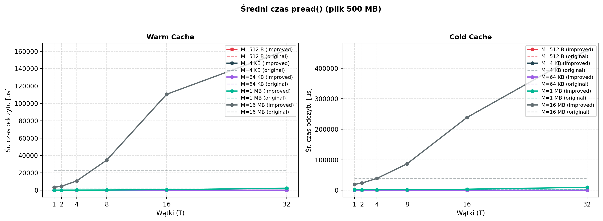
*Rysunek 9: Średni czas pojedynczego pread() — plik 500 MB (Cold Cache).*

Latencja pojedynczego `pread` rośnie wraz z liczbą wątków (Rysunek 2, 7–9) — jest to zjawisko kolejkowania na kontrolerze NVMe. Dla pliku 500 MB z limitem `MemoryMax=256M` efekt ten jest szczególnie silny, ponieważ każda strona musi być doczytywana z dysku, a równoległe żądania konkurują o przepustowość. Jednak całkowity czas wykonania nadal spada przy zwiększaniu wątków, ponieważ wzrost IOPS kompensuje wyższą latencję pojedynczego żądania.

#### Odpowiedzi na pytania z specyfikacji:

* **Czas działania programu w funkcji $M$ i ilości wątków:**

  Im większy rozmiar bloku $M$, tym krótszy całkowity czas działania programu, ponieważ łączna liczba operacji odczytu $N = \lceil \text{rozmiar pliku} / M \rceil$ maleje. Dla małych bloków ($M = 512\text{ B}$) i 1 wątku wykonujemy ponad $100\,000$ odczytów, co daje czas rzędu $970\text{ ms}$ (plik 50 MB). Zwiększenie bloku do $M = 64\text{ KB}$ skraca czas do $\approx 68\text{ ms}$.
  


* **Czy zwiększanie ilości wątków zmniejszy czas wykonania programu?**
  
  Tak, ale tylko do pewnego momentu. Na dysku fizycznym (Cold Cache) wielowątkowość daje duże zyski: dla $M=512\text{ B}$ przyspieszenie z $970\text{ ms}$ do $171\text{ ms}$ (**5.7x** przy 32 wątkach), a dla $M=4\text{ KB}$ z $935\text{ ms}$ do $92\text{ ms}$ (**10.2x** przy 32 wątkach). Wynika to z faktu, że kontroler NVMe obsługuje wiele równoległych kolejek komend sprzętowych.
  Dla pliku w pamięci RAM (Warm Cache) odczyty są niemal natychmiastowe, a overhead współbieżności (mutex, kanał) przewyższa zysk z równoległości, dlatego wersja z wieloma wątkami może być nawet wolniejsza od wersji oryginalnej.


* **Czy zwiększenie ilości wątków zmniejszy latencję operacji odczytywania danych?**
  
  Nie. Latencja pojedynczego odczytu rośnie tak samo jak liczba wątków (Rysunek 2).
  Dla $M=4\text{ KB}$ rośnie z $63\text{ µs}$ przy 1 wątku do $171\text{ µs}$ przy 32 wątkach. Żądania czekają w kolejkach kontrolera dyskowego, jednak sumaryczna przepustowość (IOPS) rośnie, więc całkowity czas programu spada.


* **Jak wpłynie na latencję posiadanie pliku w pamięci systemu operacyjnego (file cache)?**
  
  Posiadanie pliku w *Page Cache* bardzo przyspiesza pojedynczy odczytu (dla $M=512\text{ B}$ z $9.5\text{ µs}$ dla dysku do wartości rzędu $1\text{ µs}$ dla RAM). W stanie Warm Cache czas działania programu dla większych $M$ staje się niemal płaski i dominuje w nim wyłącznie czas liczenia hashu.

  Ograniczenie cache za pomocą `MemoryMax=256M` (plik 500 MB) powoduje drastyczny spadek wydajności — dla $M=512\text{ B}$ czas wzrasta z $3872\text{ ms}$ (200 MB bez limitu) do $70752\text{ ms}$ (**18.3x**), ponieważ plik nie mieści się w cache i każda strona musi być doczytywana z dysku.

---

### Throughput

Program czyta plik sekwencyjnie i oblicza sumę skrótów ($K=1$). Wersja oryginalna (`throughput_original`) używa synchronicznej pętli `read_exact_at()`, natomiast wersja poprawiona (`throughput`) mapuje cały plik do pamięci wirtualnej procesu za pomocą `mmap`.

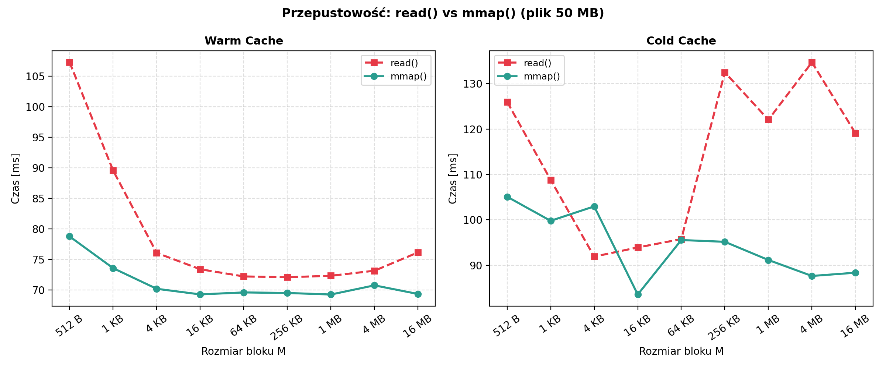
*Rysunek 10: Porównanie czasu wykonania sekwencyjnego odczytu przed (read) i po poprawce (mmap) dla pliku 50 MB, pamięci RAM (Warm) i dysku (Cold).*

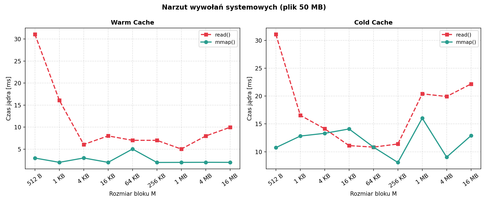
*Rysunek 11: Porównanie czasu spędzonego w przestrzeni jądra (system CPU time) dla read() vs mmap() w funkcji wielkości bloku M (plik 50 MB).*

#### Wyniki pomiarów — Warm Cache (plik 50 MB w RAM):

| Rozmiar bloku $M$ | read() [ms] | mmap() [ms] | Przyspieszenie | Czas jądra read() [ms] | Czas jądra mmap() [ms] |
|:---:|:---:|:---:|:---:|:---:|:---:|
| **512 B** | 107.3 | 78.8 | **1.36x** | 31.1 | 3.0 |
| **1 KB** | 89.5 | 73.6 | **1.22x** | 16.1 | 2.0 |
| **4 KB** | 76.1 | 70.2 | 1.08x | 6.1 | 3.0 |
| **16 KB** | 73.4 | 69.3 | 1.06x | 8.0 | 2.0 |
| **64 KB** | 72.2 | 69.6 | 1.04x | 7.0 | 5.0 |
| **256 KB** | 72.1 | 69.5 | 1.04x | 7.0 | 2.0 |
| **1 MB** | 72.3 | 69.3 | 1.04x | 5.0 | 2.0 |
| **4 MB** | 73.1 | 70.8 | 1.03x | 8.0 | 2.0 |
| **16 MB** | 76.1 | 69.3 | 1.10x | 10.0 | 2.0 |

#### Wyniki pomiarów — Cold Cache (plik 50 MB, odczyt z dysku):

| Rozmiar bloku $M$ | read() [ms] | mmap() [ms] | Przyspieszenie | Czas jądra read() [ms] | Czas jądra mmap() [ms] |
|:---:|:---:|:---:|:---:|:---:|:---:|
| **512 B** | 126.0 | 105.1 | **1.20x** | 31.1 | 10.7 |
| **1 KB** | 108.8 | 99.8 | 1.09x | 16.6 | 12.8 |
| **4 KB** | 91.9 | 103.0 | 0.89x | 14.1 | 13.3 |
| **16 KB** | 93.9 | 83.6 | 1.12x | 11.1 | 14.1 |
| **64 KB** | 95.8 | 95.6 | 1.00x | 10.8 | 10.8 |
| **256 KB** | 132.5 | 95.2 | **1.39x** | 11.4 | 8.1 |
| **1 MB** | 122.1 | 91.2 | 1.34x | 20.4 | 16.0 |
| **4 MB** | 134.7 | 87.6 | **1.54x** | 19.9 | 9.0 |
| **16 MB** | 119.1 | 88.4 | 1.35x | 22.2 | 12.9 |

#### Wpływ rozmiaru pliku na czas sekwencyjnego odczytu:

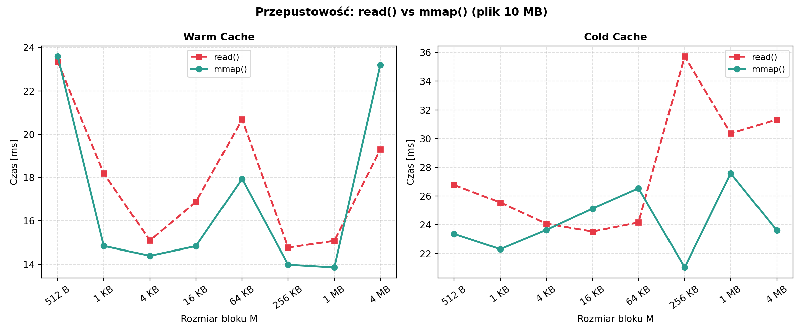
*Rysunek 12: read() vs mmap() — plik 10 MB.*

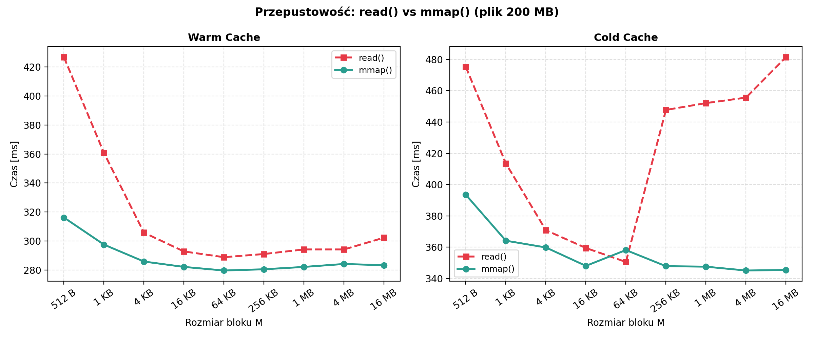
*Rysunek 13: read() vs mmap() — plik 200 MB.*

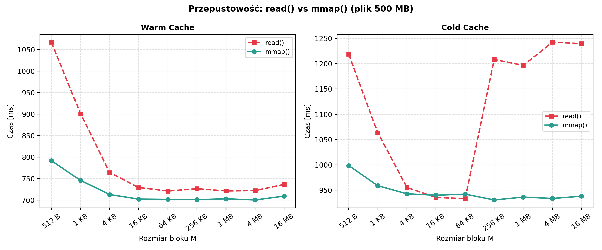
*Rysunek 14: read() vs mmap() — plik 500 MB (MemoryMax=256M).*

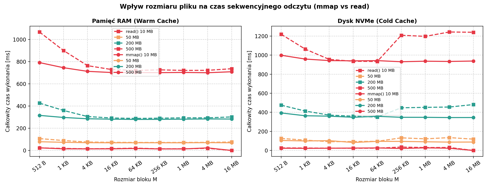
*Rysunek 15: Czas sekwencyjnego odczytu w funkcji rozmiaru pliku (10–500 MB) dla read() vs mmap() i różnych rozmiarów bloków M.*

| Rozmiar bloku $M$ | 10 MB read [ms] | 50 MB read [ms] | 200 MB read [ms] | 500 MB (256M) read [ms] | 10 MB mmap [ms] | 50 MB mmap [ms] | 200 MB mmap [ms] | 500 MB (256M) mmap [ms] |
|:---:|:---:|:---:|:---:|:---:|:---:|:---:|:---:|:---:|
| **512 B** | 26.8 | 126.0 | 475.2 | **1218.9** | 23.4 | 105.1 | 393.5 | **998.7** |
| **1 MB** | 30.4 | 122.1 | 452.1 | **1196.8** | 27.6 | 91.2 | 347.6 | **936.3** |
| **16 MB** | — | 119.1 | 481.4 | **1239.7** | — | 88.4 | 345.4 | **938.0** |

Czas rośnie proporcjonalnie do rozmiaru pliku dla plików mieszczących się w cache (10–200 MB). Plik 500 MB z limitem `MemoryMax=256M` pokazuje wyraźny spadek wydajności — dla $M=512\text{ B}$ czas `read` wzrasta z $475\text{ ms}$ (200 MB) do $1219\text{ ms}$ (**2.6x**), a `mmap` z $394\text{ ms}$ do $999\text{ ms}$ (**2.5x**). Przewaga `mmap` pozostaje stabilna (**1.22x**), co potwierdza, że eliminacja wywołań systemowych działa niezależnie od presji pamięciowej.

#### Czas jądra (system CPU time) — porównanie wszystkich rozmiarów plików:

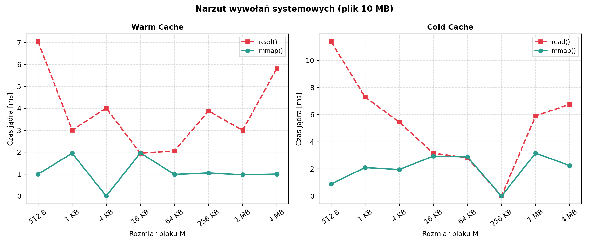
*Rysunek 16: Czas jądra read() vs mmap() — plik 10 MB.*

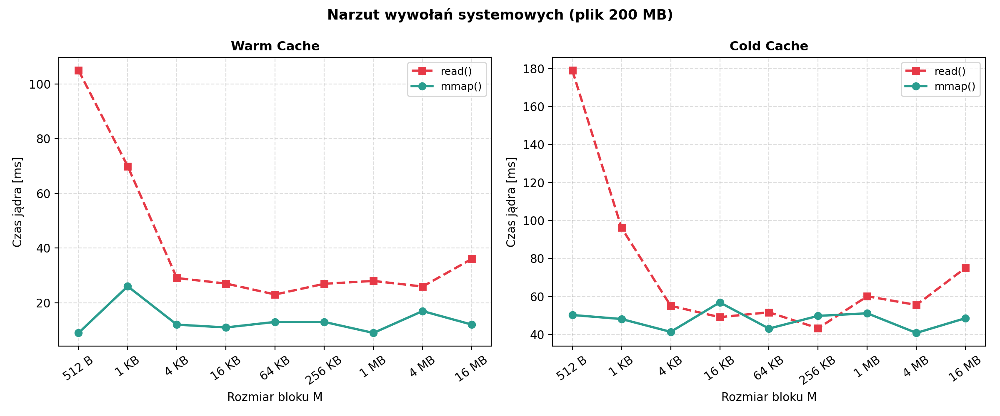
*Rysunek 17: Czas jądra read() vs mmap() — plik 200 MB.*

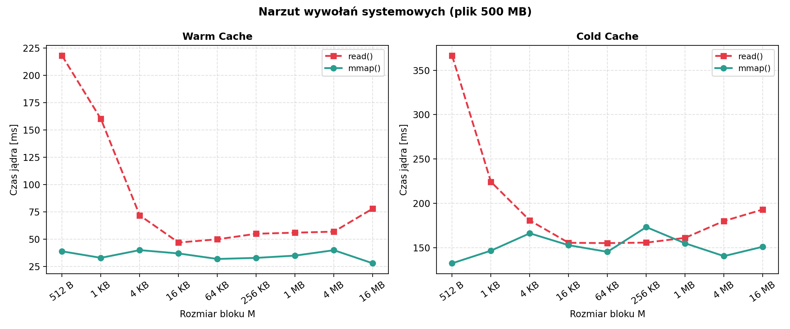
*Rysunek 18: Czas jądra read() vs mmap() — plik 500 MB.*

Porównanie czasu jądra (Rysunek 16–18) wyraźnie pokazuje, że `mmap` redukuje narzut systemowy o **60–80%** względem `read` dla małych bloków ($M \le 4\text{ KB}$). Dla większych plików (200–500 MB) różnica ta jest jeszcze bardziej widoczna: przy $M=512\text{ B}$ i pliku 500 MB, `read` spędza w jądrze kilkadziesiąt milisekund, podczas gdy `mmap` ogranicza się do pojedynczego wywołania systemowego mapowania. Wykresy potwierdzają, że przewaga `mmap` wynika głównie z eliminacji przejść przestrzeń użytkownika/jądro, a nie z szybszego dostępu do danych — czas użytkownika (user CPU) jest podobny dla obu metod.

#### Odpowiedzi na pytania z specyfikacji:

* **Czas działania programu w funkcji $M$ (przed poprawką oraz po poprawce):**

  Czas programu po poprawce (`mmap`) jest niemal płaski i praktycznie nie zależy od rozmiaru bloku $M$ (dla Warm Cache wynosi $\approx 88-100\text{ ms}$ zarówno dla $512\text{ B}$, jak i dla $16\text{ MB}$).
  Dla programu przed poprawką (`read`) czas dla małych bloków jest wyższy, po czym wraz ze wzrostem $M$ zbliża się do czasu `mmap`. Dla $M=512\text{ B}$ wersja `read` wykonuje ponad $100\,000$ wywołań systemowych, podczas gdy `mmap` mapuje plik jednokrotnie.


* **Czy jest jakiś schemat odczytywania pliku, gdzie mmap zmniejszy obciążenie procesora ponad read?**
  
  Tak, odczyt małymi porcjami danych (małe $M$). Dla $M=512\text{ B}$ procesor spędza do $31.1\text{ ms}$ w przestrzeni jądra przy `read`, a tylko $10.7\text{ ms}$ przy `mmap` (Cold Cache, plik 50 MB).


* **Jak wpłynie na latencję posiadanie pliku w pamięci systemu operacyjnego (file cache)?**
  
  Przy sekwencyjnym odczycie wpływ cache jest mniejszy niż przy odczycie losowym. Jądro Linuksa przy sekwencyjnym przetwarzaniu uruchamia mechanizm *readahead*, doczytując strony z wyprzedzeniem.

---

### Pipeline

Program bada przeplot odczytu sekwencyjnego z wielokrotnym hashowaniem MD5 (*Key Stretching*, parametr $K$). Wersja oryginalna wykonuje odczyt i obliczenia synchronicznie ($T = T_{read} + T_{compute}$). Wersja poprawiona implementuje pipeline producent-konsument połączony kanałem `sync_channel(4)`, dzięki czemu $T \approx \max(T_{read}, T_{compute})$.

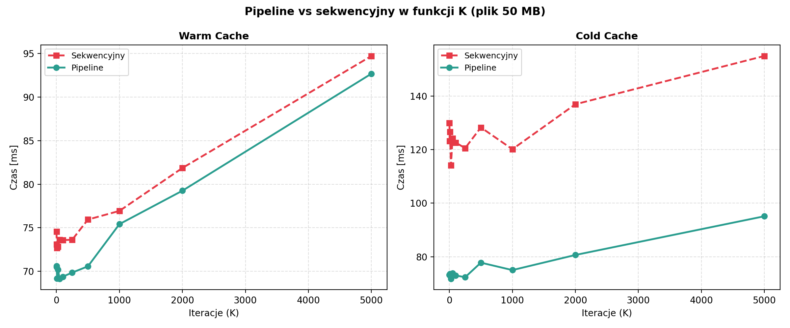
*Rysunek 19: Czas wykonania w funkcji parametru K dla M = 1 MB (plik 50 MB, przed vs po poprawce).*

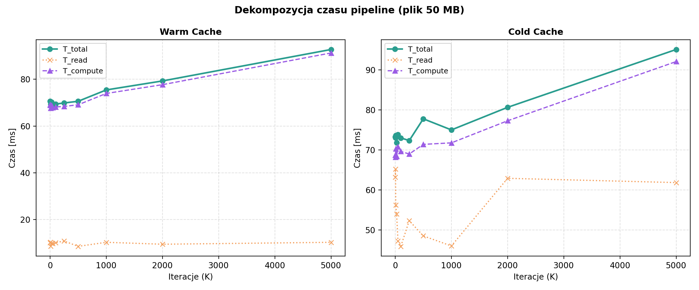
*Rysunek 20: Dekompozycja czasu pipeline na składową I/O (T_read) i CPU (T_compute), potwierdzająca regułę T_total ≈ max(T_read, T_compute) (plik 50 MB).*

#### Wyniki pomiarów — Warm Cache (plik 50 MB, $M = 1\text{ MB}$):

| Liczba iteracji $K$ | Pipeline [ms] | Original [ms] | Przyspieszenie | Czas odczytu [ms] | Czas obliczeń [ms] |
|:---:|:---:|:---:|:---:|:---:|:---:|
| **1** | 70.6 | 74.6 | 1.06x | 10.1 | 69.1 |
| **10** | 69.2 | 72.7 | 1.05x | 8.7 | 67.6 |
| **100** | 69.4 | 73.6 | 1.06x | 10.2 | 68.1 |
| **500** | 70.6 | 75.9 | 1.08x | 8.6 | 69.1 |
| **1000** | 75.4 | 76.9 | 1.02x | 10.3 | 73.9 |
| **5000** | 92.7 | 94.7 | 1.02x | 10.3 | 91.2 |

#### Wyniki pomiarów — Cold Cache (plik 50 MB, $M = 1\text{ MB}$):

| Liczba iteracji $K$ | Pipeline [ms] | Original [ms] | Przyspieszenie | Czas odczytu [ms] | Czas obliczeń [ms] |
|:---:|:---:|:---:|:---:|:---:|:---:|
| **1** | 73.3 | 129.9 | **1.77x** | 63.2 | 68.7 |
| **10** | 73.7 | 126.7 | **1.72x** | 56.3 | 70.3 |
| **100** | 73.0 | 122.6 | **1.68x** | 45.9 | 69.7 |
| **500** | 77.8 | 128.3 | **1.65x** | 48.5 | 71.4 |
| **1000** | 75.0 | 120.1 | **1.60x** | 46.0 | 71.8 |
| **5000** | 95.1 | 155.0 | **1.63x** | 61.9 | 92.1 |

#### Wpływ rozmiaru bloku $M$ na czas pipeline (Warm Cache, różne $K$):

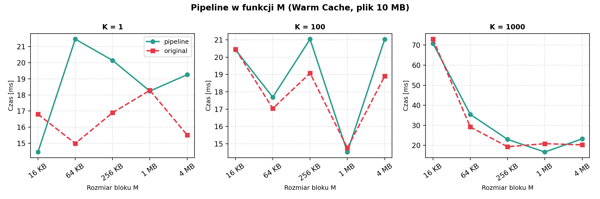
*Rysunek 21: Czas pipeline w funkcji M — plik 10 MB.*

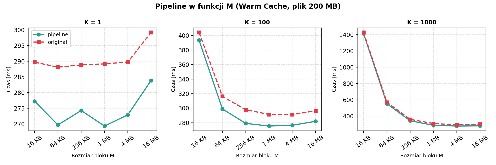
*Rysunek 22: Czas pipeline w funkcji M — plik 200 MB.*

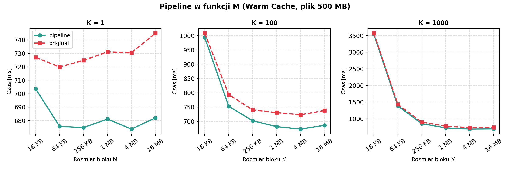
*Rysunek 23: Czas pipeline w funkcji M — plik 500 MB.*

Dla małych bloków ($M \le 64\text{ KB}$) czas rośnie ze względu na większą liczbę bloków do przetworzenia. Dla $K=1000$ i $M=16\text{ KB}$ czas jest 3–4 razy większy niż dla $M=1\text{ MB}$, ponieważ liczba bloków jest 64-krotnie większa.

#### Wpływ rozmiaru pliku na punkt równowagi $K_{opt}$:

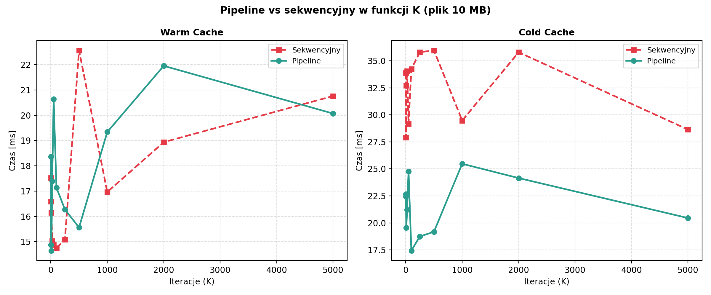
*Rysunek 24: Czas pipeline w funkcji K — plik 10 MB.*

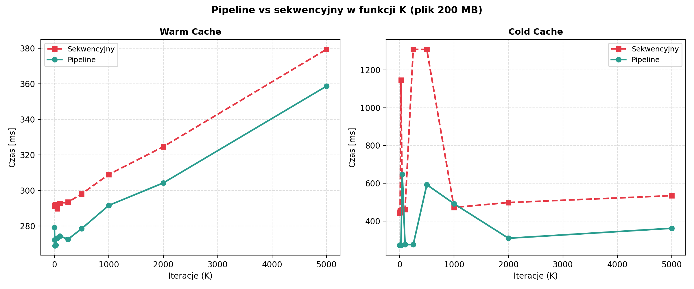
*Rysunek 25: Czas pipeline w funkcji K — plik 200 MB.*

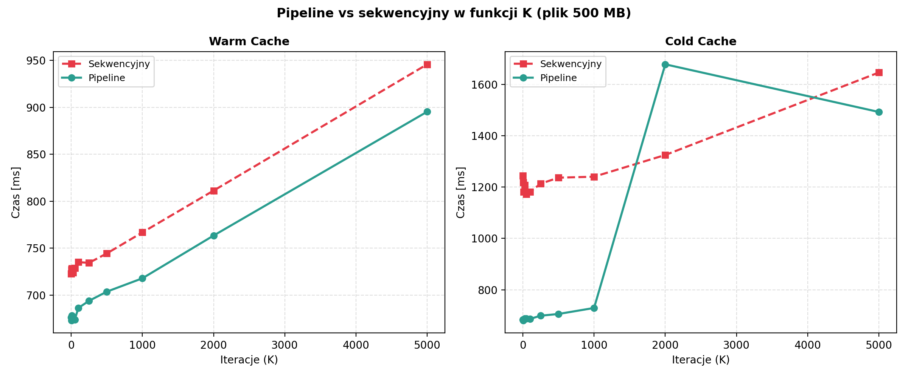
*Rysunek 26: Czas pipeline w funkcji K — plik 500 MB.*

Porównanie wpływu rozmiaru pliku na punkt równowagi (Rysunek 24–26) pokazuje, że wraz ze wzrostem rozmiaru pliku rośnie czas odczytu $T_{read}$, co przesunęłoby $K_{opt}$ w górę. Dla pliku 500 MB z limitem `MemoryMax=256M` czas odczytu jest znacznie wyższy niż dla plików mieszczących się w cache — $T_{read} = 560\text{ ms}$ vs $16\text{ ms}$ (10 MB). Pipeline daje największe przyspieszenie dla tego pliku (**1.82x**), ponieważ $T_{read}$ jest porównywalny z $T_{compute}$ i przeplot znacząco skraca czas całkowity. Na szybkim dysku NVMe $K_{opt}$ nadal wynosi 1.

#### Wyniki pomiarów — Pipeline (plik 500 MB, $M = 1\text{ MB}$, MemoryMax=256M):

| Liczba iteracji $K$ | Pipeline [ms] | Original [ms] | Przyspieszenie | Czas odczytu [ms] | Czas obliczeń [ms] |
|:---:|:---:|:---:|:---:|:---:|:---:|
| **1** | 683.7 | 1244.9 | **1.82x** | 559.8 | 680.4 |
| **10** | 684.7 | 1180.7 | **1.72x** | 556.7 | 678.0 |
| **100** | 686.5 | 1181.2 | **1.72x** | 512.6 | 678.9 |
| **1000** | 729.1 | 1240.4 | **1.70x** | 532.3 | 721.5 |

#### Dekompozycja czasu pipeline — porównanie wszystkich rozmiarów plików:

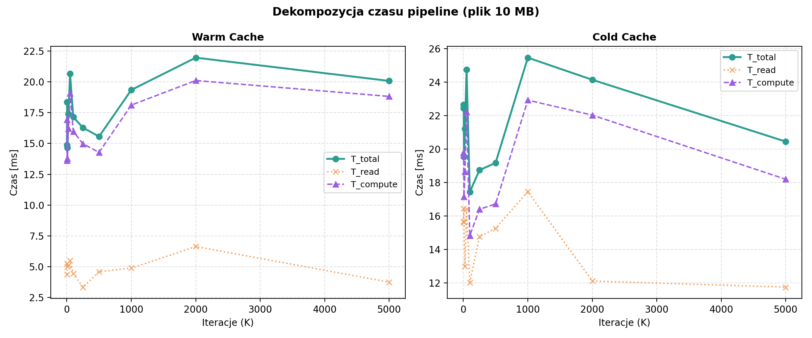
*Rysunek 27: Dekompozycja czasu pipeline — plik 10 MB.*

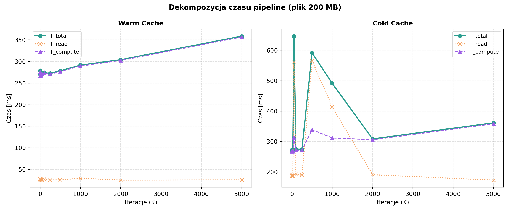
*Rysunek 28: Dekompozycja czasu pipeline — plik 200 MB.*

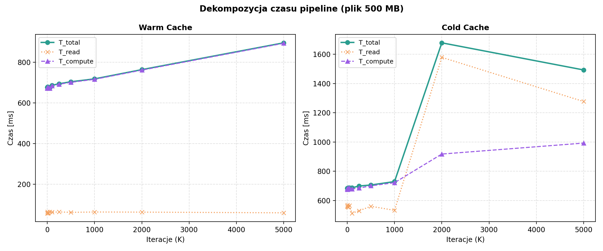
*Rysunek 29: Dekompozycja czasu pipeline — plik 500 MB.*

Dekompozycja czasu (Rysunek 27–29) potwierdza regułę 
$T_{total} \approx \max(T_{read}, T_{compute})$ dla wszystkich rozmiarów plików — z niewielkim dodatkiem (~5 ms) na narzut synchronizacji kanału między wątkami.
Wersja oryginalna (bez pipeline) zawsze 
pokazuje $T_{total} = T_{read} + T_{compute}$, co dla dużych $K$ daje 
czas niemal dwukrotnie większy niż wersja z pipeline.

#### Odpowiedzi na pytania:

* **Czas działania programu w funkcji $M$ i $K$:**

  W wersji oryginalnej czas to suma $T = T_{read} + T_{compute}$. W wersji pipeline czas to $T \approx \max(T_{read}, T_{compute})$ (Rysunek 20, Rysunek 27–29).
  
  Dla małych bloków ($M \le 64\text{ KB}$) czas rośnie ze względu na większą liczbę bloków do przetworzenia (Rysunek 22–23). Dla $K=1000$ i $M=16\text{ KB}$ czas jest 3–4 razy większy niż dla $M=1\text{ MB}$, ponieważ liczba bloków jest 64-krotnie większa.


* **Punkt równowagi $K_{opt}$ dla $M = 1\text{ MB}$:**

  $K_{opt}$ to minimalna wartość $K$, przy której $T_{compute} \ge T_{read}$ — od tego punktu pipeline zaczyna dawać zysk, ponieważ faza obliczeniowa staje się dominująca i maskuje czas odczytu.

  - **Cold Cache (odczyt z dysku):** Z tabeli wynika, że dla $K=1$ czas obliczeń wynosi $68.7\text{ ms}$, a odczytu $63.2\text{ ms}$. Ponieważ $T_{compute} > T_{read}$ już dla $K=1$, **$K_{opt} = 1$** — pipeline daje zysk w całym badanym zakresie $K$, przyspieszenie wynosi **1.60–1.77x**.
  - **Warm Cache (plik w RAM):** Dla $K=1$ czas obliczeń to $69.1\text{ ms}$, a odczytu $10.1\text{ ms}$. Również $T_{compute} \gg T_{read}$, więc **$K_{opt} = 1$** i zysk pipeline jest niewielki (**1.02–1.08x**), ponieważ i tak $T_{read}$ jest pomijalny.
  - **Plik 500 MB z MemoryMax=256M:** Dla $K=1$ czas odczytu rośnie do $560\text{ ms}$, a obliczeń do $680\text{ ms}$. Pipeline daje przyspieszenie **1.82x**, ponieważ $T_{read}$ jest porównywalny z $T_{compute}$ i przeplot znacząco skraca czas całkowity.
  - Na wolniejszym nośniku, $K_{opt}$ wypadłby przy wyższych wartościach.


* **Czy dodanie większej ilości wątków po stronie czytania lub funkcji hashującej zmieni cokolwiek?**
 
  - **Więcej wątków czytających:** Nie — przy odczycie sekwencyjnym pojedynczy wątek nasyca łącze dyskowe.
  - **Więcej wątków hashujących:** Tak, dla dużych $K$. XOR jest przemienny, więc bloki mogą być hashowane niezależnie.

---

### Memory Pressure

Gdy rozmiar przetwarzanego pliku przekracza wielkość dostępnej pamięci operacyjnej 
(lub gdy proces uruchomiony jest z limitem pamięci, 
np. `systemd-run --scope -p MemoryMax=16M`), 
system operacyjny staje przed koniecznością ciągłego zwalniania stron pamięci 
podręcznej (*page eviction* / algorytm LRU), aby zrobić miejsce na nowe bloki.

Pomiary wykonano z limitem `MemoryMax=16M` (plik testowy: `50 MB`), 
co wymusza na systemie ciągłe wyrzucanie stron z cache podczas przetwarzania.

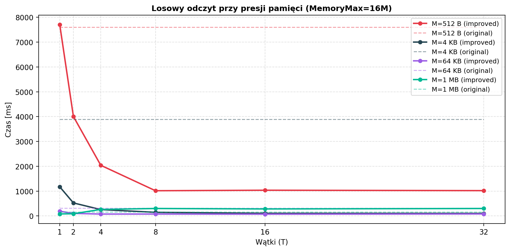
*Rysunek 30: Czas wykonania losowego odczytu przy limicie pamięci 16 MB (Cold Cache, plik 50 MB) w funkcji liczby wątków.*

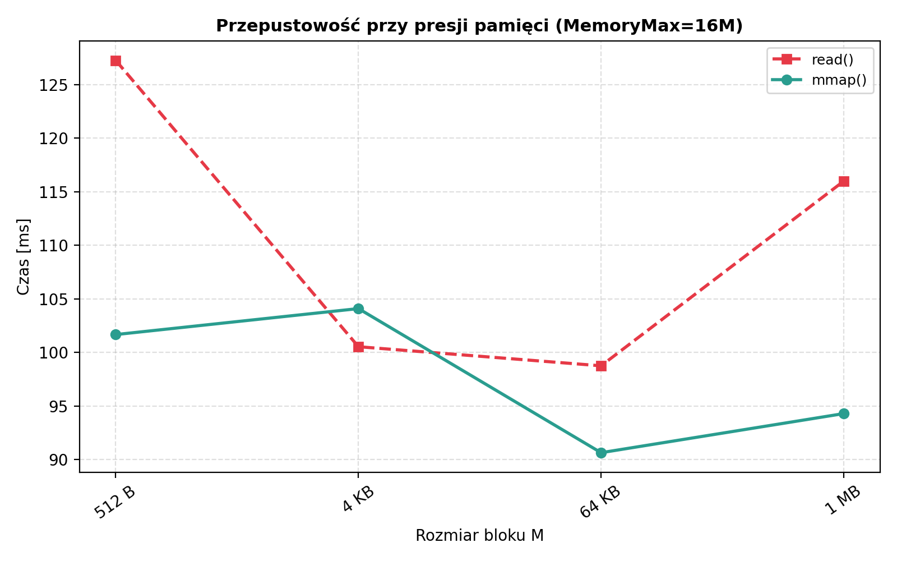
*Rysunek 31: Porównanie mmap() vs read() przy limicie pamięci 16 MB (Cold Cache, plik 50 MB) w funkcji rozmiaru bloku M.*

#### Wyniki pomiarów — Latency (Cold Cache, MemoryMax=16M):

| Rozmiar bloku $M$ | Original 1T [ms] | Po poprawce 1T [ms] | Po poprawce 4T [ms] | Po poprawce 8T [ms] |
|:---:|:---:|:---:|:---:|:---:|
| **512 B** | 7598.1 | 7707.7 | 2038.6 | 1014.4 |
| **4 KB** | 3886.2 | 1172.0 | 254.3 | 144.8 |
| **64 KB** | 312.3 | 188.1 | 74.6 | 75.4 |
| **1 MB** | 157.2 | 80.1 | 260.3 | 298.9 |

#### Średni czas odczytu — Latency (Cold Cache, MemoryMax=16M):

| Rozmiar bloku $M$ | Original 1T [µs] | Po poprawce 1T [µs] | Po poprawce 4T [µs] | Po poprawce 8T [µs] |
|:---:|:---:|:---:|:---:|:---:|
| **512 B** | 74.2 | 71.2 | 76.7 | 77.3 |
| **4 KB** | 303.6 | 86.6 | 78.3 | 86.7 |
| **64 KB** | 390.4 | 231.3 | 264.9 | 258.5 |
| **1 MB** | 1538.7 | 1538.7 | 3410.1 | 7724.4 |

#### Wyniki pomiarów — Throughput (Cold Cache, MemoryMax=16M):

| Rozmiar bloku $M$ | read() [ms] | mmap() [ms] | Przyspieszenie |
|:---:|:---:|:---:|:---:|
| **512 B** | 127.3 | 101.7 | 1.25x |
| **4 KB** | 100.5 | 104.1 | 0.97x |
| **64 KB** | 98.8 | 90.6 | 1.09x |
| **1 MB** | 116.0 | 94.3 | **1.23x** |

#### Wnioski:

* **Wpływ presji pamięciowej na odczyt losowy:** 

  Presja pamięci drastycznie degraduje wydajność (Rysunek 30). Dla $M=512\text{ B}$ i 1 wątku czas wzrósł z $970\text{ ms}$ (bez limitu) do $7598\text{ ms}$ (**7.8-krotnie**). Średni czas pojedynczego `pread` wzrósł z $9.5\text{ µs}$ do $74.2\text{ µs}$ (**7.8-krotnie**). Gdy plik nie mieści się w cache, system musi przy każdym losowym odczycie załadować stronę z dysku, a potem ją natychmiast zwolnić, by zrobić miejsce na kolejną. Przy wielowątkowości zyski są nadal duże (dla $M=512\text{ B}$ z $7598\text{ ms}$ do $1014\text{ ms}$ przy 8 wątkach, **7.5x**), ponieważ kontroler dysku obsługuje równoległe żądania.


* **Wpływ presji pamięciowej na odczyt sekwencyjny:** 

  Spadek wydajności jest umiarkowany (Rysunek 31). Dla $M=512\text{ B}$ czas `read` wzrósł z $126\text{ ms}$ do $127\text{ ms}$, a `mmap` z $105\text{ ms}$ do $102\text{ ms}$. Przy odczycie sekwencyjnym system może bezkarnie zwalniać najstarsze strony, nie ryzykując konieczności ich ponownego doczytywania, więc narzut jest znacznie mniejszy niż przy dostępie losowym. Dla większych bloków ($M=1\text{ MB}$) mmap zachowuje przewagę (**1.23x**), podczas gdy dla średnich bloków ($4\text{ KB}$) read jest nieco szybszy — wynika to z faktu, że przy presji pamięciowej mmap generuje więcej page faultów, które muszą być obsługiwane przez jądro.
